# wunderbar-buttoncap

**Labelled button caps for Wunder-Bar M4 bar guns, ready to 3D print.**

A bar gun has a row of buttons, one for each drink. This project makes replacement caps for them:

- **Round caps** (10 mm) with a short code for the drink, such as PJ for pickle juice or JAVA for coffee.
  There are caps for every label in the commercial Wunder-Bar catalogue, and for many more drinks:
  spirits, juices, syrups, cocktails.
- **Long caps** (20.3 x 8.3 mm) for the long button, with a full word such as VODKA or SODA.

Each cap is a two-colour print. The label is a 0.4 mm inlay, flush with the face, so it does not wear off.

## Download and print

1. Download `wunderbar-buttoncap-<version>.zip` from the
   [latest release](https://github.com/tinic/wunderbar-buttoncap/releases/latest) and unzip it.
2. Open `round/index.html` or `long/index.html` in a browser. It shows every cap. Use the filter box
   to find one.
3. Open `<type>/3mf/<NAME>.3mf` in your slicer. The file holds one object with two parts: `Cap` and
   `Label`.
4. Give each part its filament. Put the label face down on the plate.

Tips:

- The smallest letters are about 1.9 mm high with 0.37 mm strokes. A 0.4 mm nozzle prints most labels.
  For the long names, print the `Label` part with a 0.2 mm nozzle if your printer has one.
- The caps keep the colours of the original Wunder-Bar caps where there is one: for example, COKE is a
  red cap with white letters. Other caps are white with black letters. Use any colours you like.
- The round cap snaps onto the button. The bore has two key flats and a snap rib.
- The long cap snaps onto the long button. Its back pocket has a snap ridge along both long walls.

## All caps

### Round caps

<!-- caps:round:start -->
254 caps. Generated by `make docs` from `labels/round.csv`.

#### Letters and codes (31)

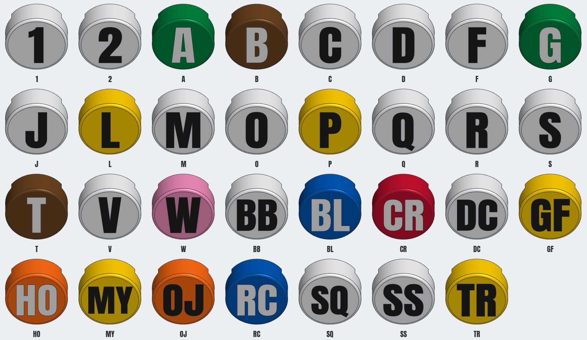

#### Wunder-Bar catalogue (81)

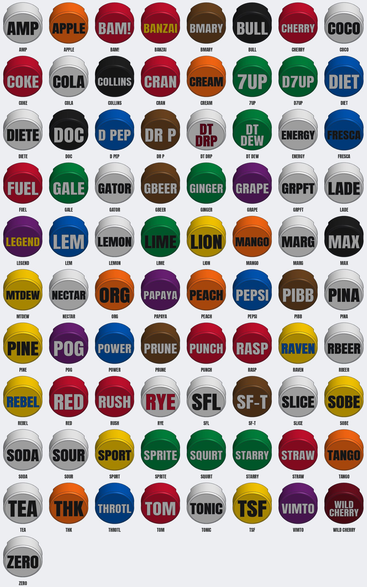

#### Sodas and mixers (28)

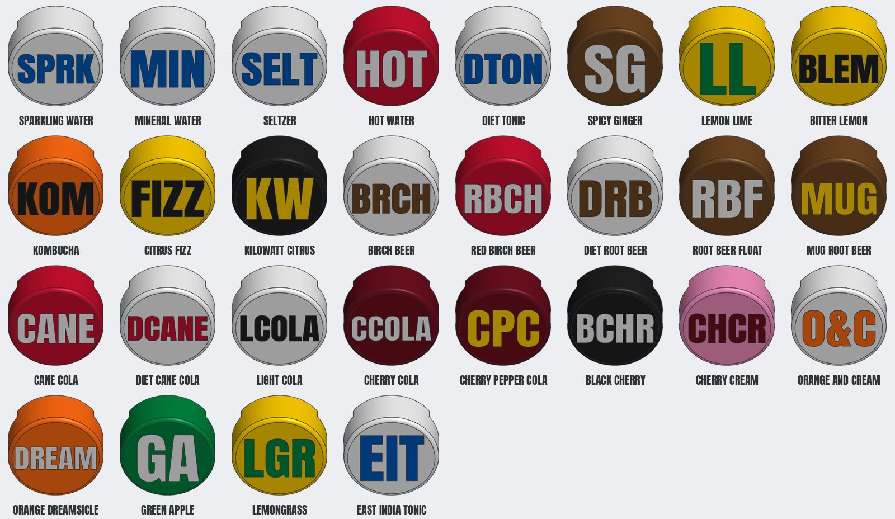

#### Coffee, tea and milk (14)

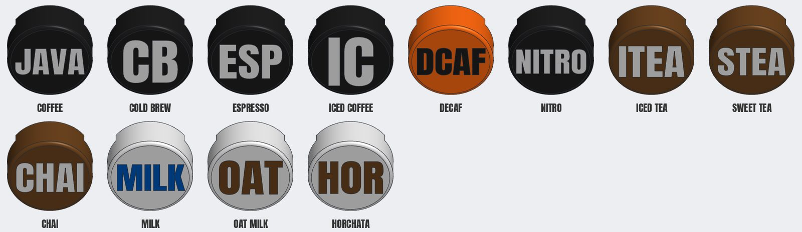

#### Juices and fruit (23)

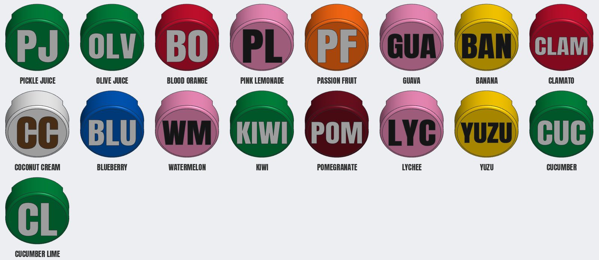

#### Syrups and flavours (13)

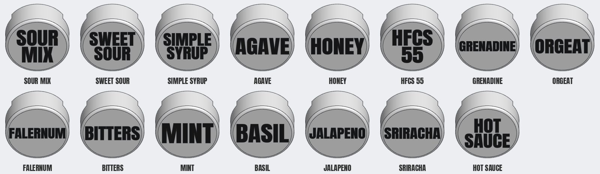

#### Spirits and liqueurs (38)

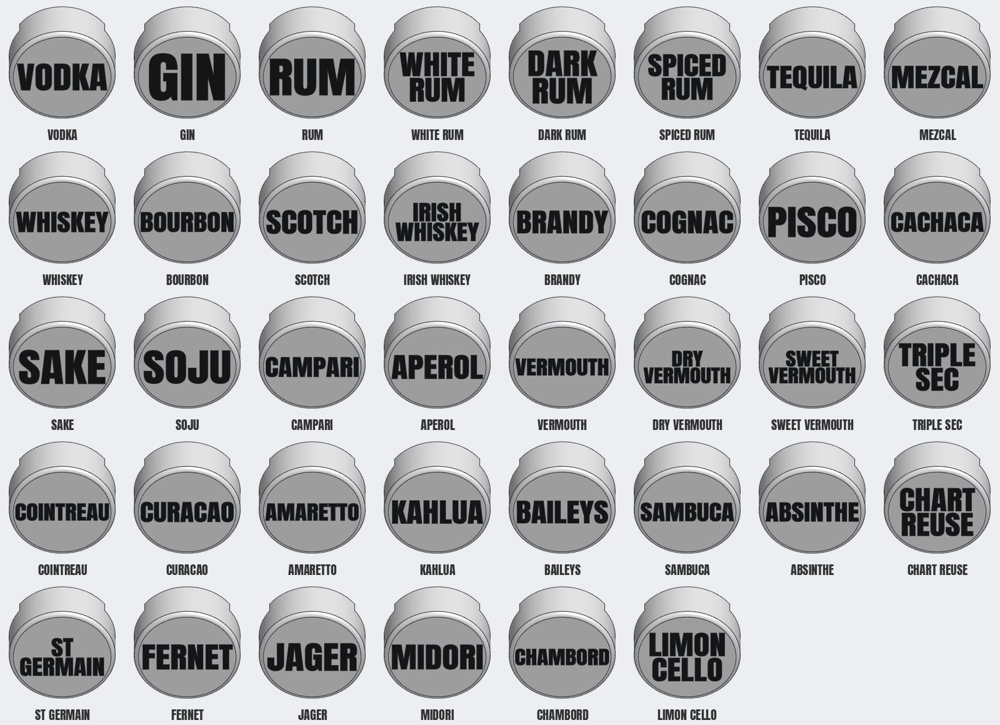

#### Wine and beer (11)

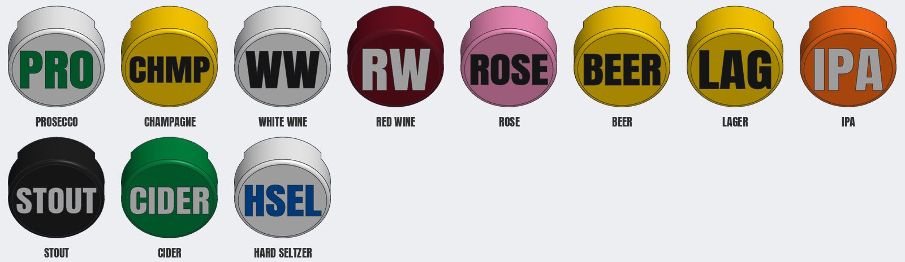

#### Cocktails (11)

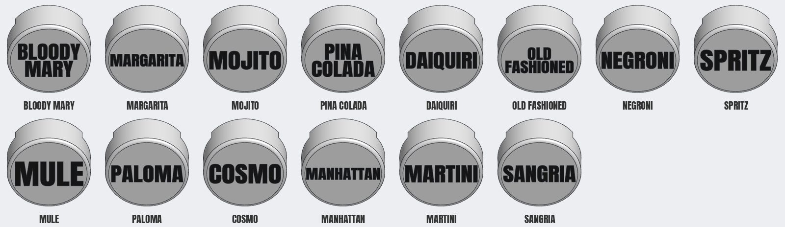

#### Service (4)

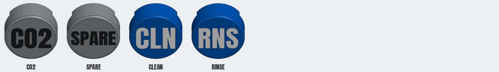
<!-- caps:round:end -->

### Long caps

<!-- caps:long:start -->
26 caps. Generated by `make docs` from `labels/long.csv`.

#### Water and soda (8)

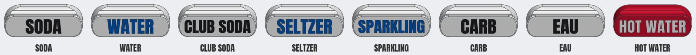

#### Mixers (11)

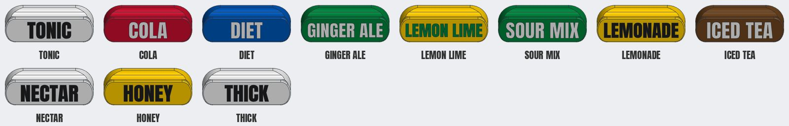

#### Spirits (7)

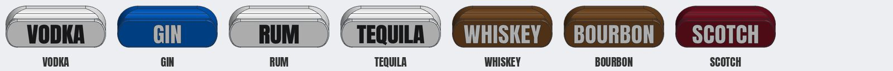
<!-- caps:long:end -->

## Cap types

| Type | Fits | Status |
|---|---|---|
| `round` | Wunder-Bar round button caps (PH10-74-xxx), 10 mm | Available |
| `long` | Wunder-Bar long button, 20.32 x 8.26 mm | Available |

## Request a label

Open an issue with the text you want, or add a row to `labels/round.csv` or `labels/long.csv` in a
pull request. On a round cap, use a short code: 2 to 4 characters give letters of 3.5 mm or more.
A long cap takes a word of up to 5 characters at 4.2 mm, and up to 9 characters at about 3.7 mm.

## Build

You need:

- SolidCraft, with `solidcraft-cli` on the `PATH`
- Python 3.10 or later
- `make`, and `gh` for releases

| Command | Result |
|---|---|
| `make` | One 3MF and one preview PNG for each label in `build/round/`, then `build/round/index.html` and `contact-sheet.png` |
| `make docs` | The preview sheets in `docs/` and the "All caps" section of this README |
| `make dist VERSION=v0.2.0` | `dist/wunderbar-buttoncap-v0.2.0.zip` |
| `make release VERSION=v0.2.0` | A draft GitHub release with the archive. Write `RELEASE_NOTES.md` first. |
| `tools/plate.py plates/readme-photo.json build/readme-photo.3mf` | A Bambu Studio project with the caps of the plate spec, each part set to its filament slot; see [docs/bambu-3mf.md](docs/bambu-3mf.md) |
| `make clean` | Removes `build/` and `dist/` |

Each 3MF mesh is simplified to 8 000 triangles (round) or 11 000 (long), at most 0.024 mm from the exact
shape. `make` makes a Python virtual environment in `.venv`. It builds only the caps whose label, colours,
design or font changed. `tools/build.py --force` builds all caps again.

The builds run on a local computer: SolidCraft is not available on the CI runners.

### Labels

The labels are in `labels/<type>.csv`:

| Column | Meaning |
|---|---|
| `file` | The drink, and the output name: `<file>.3mf` and `<file>.png`. Each name must be unique. |
| `label` | The text on the cap: a short code of 2 to 4 characters gives the biggest letters. A `\|` breaks the line at that point. |
| `group` | The section of the gallery and of this README. |
| `cap`, `letter` | Colour names for the preview and the 3MF material hint: White, Black, Grey, Red, Green, Blue, Yellow, Orange, Pink, Brown, Purple, Maroon, Burgundy. |
| `source` | `wunderbar` for the labels of the commercial caps, `house` for the others. |

`labels/wunderbar-catalog.csv` lists every commercial round cap in the Wunder-Bar catalogue, with the
part numbers and colours.

The build fits each label to the face. It uses the largest capital height, up to 7 mm, that keeps every
line inside a 4.5 mm radius. A label with spaces goes on two lines when that makes the letters at least
12% bigger.

### Design

`cad/round/GunCap.sc` is a parametric SolidCraft design, made from the original SolidWorks part. Its
volume with a "B" label agrees with the original to 0.1%. Units are millimetres. The label face is on
Z = 0 and the cap extends to +Z.

| Parameter | Value | Meaning |
|---|---|---|
| `cap_d` | 10 | Outside diameter |
| `cap_h` | 4.5 | Height, label face to back |
| `face_r` | 0.4 | Round on the label face edge |
| `back_r` | 0.15 | Round on the back edge |
| `notch_z`, `notch_w` | 3.3, 8 | Side notches: start height and width across the flats |
| `bore_d`, `bore_floor` | 7.45, 1.7 | Bore diameter and floor height (the bore is 2.8 mm deep) |
| `key_w`, `lead_r` | 6, 0.7 | Key flats in the bore and their lead-in round |
| `mouth_r` | 0.15 | Round on the bore mouth |
| `rib_d`, `rib_z`, `rib_flat`, `rib_ramp` | 7.2, 3.5, 0.2, 0.4 | Snap rib in the bore |
| `label_depth` | 0.4 | Label inlay depth |
| `label_h`, `Label` | 7, B | Label capital height and text (the build sets both for each label) |

`cad/long/LongCap.sc` is the long cap, also made from the original SolidWorks part (`GunCapLarge`), with
the parameters `cap_l`, `cap_w`, `cap_h`, `pocket_l`, `pocket_w`, `pocket_d`, `face_r`, `back_r`,
`mouth_r`, `label_depth`, `label_h` and `Label`. Its volume with a "VODKA" label agrees with the original
to 0.3%. The four corners of the face are simpler than in the original: the S-shaped flare of the long
sides meets the rounded ends at an edge, not a blend. The face outline is the same.

The designs use SolidCraft's built-in font, so they open on any computer. The build sets the label font,
[Anton](https://github.com/googlefonts/AntonFont).

## License

| What | License |
|---|---|
| The design (`cad/`), the labels (`labels/`), and the 3MF files and previews | [CERN-OHL-P-2.0](LICENSE-CERN-OHL-P.txt) |
| The build code (`tools/`, `Makefile`) | [MIT](LICENSE-MIT.txt) |
| The font (`fonts/Anton-Regular.ttf`) | [SIL Open Font License 1.1](fonts/OFL-Anton.txt) |

## Trademarks

Product names on the labels, such as COKE or PEPSI, are trademarks of their owners. The labels are plain
text, not logos, and only name the drink that a button dispenses. This project has no connection with
Wunder-Bar or the brand owners.
