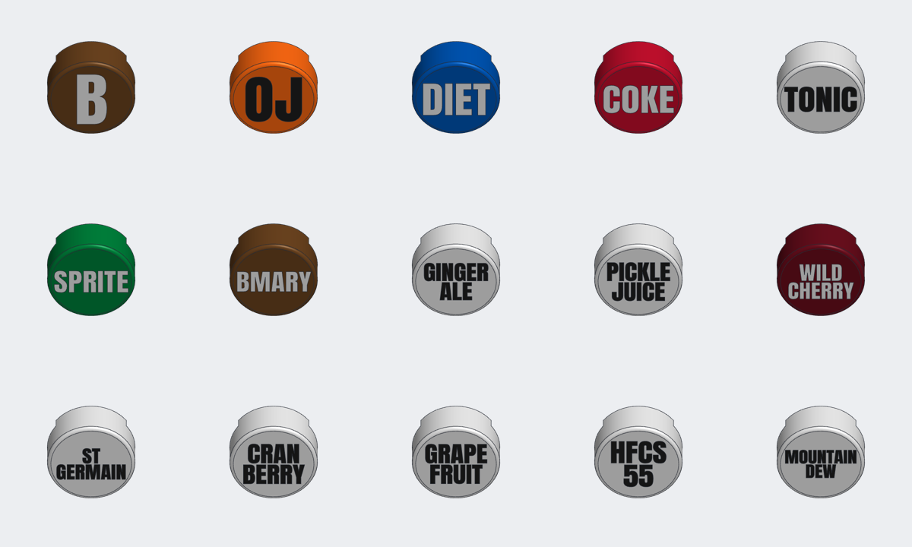

# wunderbar-buttoncap

Labelled button caps for Wunder-Bar M4 bar guns, ready to 3D print.

Each cap is a two-colour print: the cap body and a 0.4 mm label inlay, flush with the face.
Download the release archive, open `round/index.html` to find your caps, and print the 3MF files.

## Print the caps

1. Download `wunderbar-buttoncap-<version>.zip` from [Releases](https://github.com/tinic/wunderbar-buttoncap/releases) and unzip it.
2. Open `round/index.html`. Find a cap with the filter box.
3. Open `round/3mf/<NAME>.3mf` in your slicer. The file holds one object with two parts: `Cap` and `Label`.
4. Give each part its filament. The label is the face. Print the face down on the plate.

On a printer with more than one nozzle, print the `Label` part with a 0.2 mm nozzle. The smallest letters
are about 1.9 mm high with 0.37 mm strokes.

## Cap types

| Type | Fits | Status |
|---|---|---|
| `round` | Wunder-Bar round button caps (PH10-74-xxx), 10 mm | Available |
| `long` | Wunder-Bar long button (PH10-76) | Planned |

## Labels

The labels are in `labels/<type>.csv`:

| Column | Meaning |
|---|---|
| `file` | The output file name: `<file>.3mf` and `<file>.png`. It must be unique. |
| `label` | The text on the cap. A `|` breaks the line at that point. |
| `cap`, `letter` | Colour names for the preview and the 3MF material hint (White, Black, Grey, Red, Green, Blue, Yellow, Orange, Pink, Brown, Purple, Maroon, Burgundy). |
| `source` | `wunderbar` for the commercial Wunder-Bar labels, `house` for our own. |

`labels/wunderbar-catalog.csv` lists every commercial round cap from the Wunder-Bar catalogue, with
part numbers and colours. The `wunderbar` rows of `round.csv` take one colour set per label from it.

The build fits each label to the face. It uses the largest capital height (up to 7 mm) that keeps every
line inside a 4.5 mm radius. A label with spaces goes on two lines when that makes the letters at least
12% bigger.

To add a label, add a row to `labels/round.csv` and run `make`. Only the new and changed caps are built.

## Build

Requirements:

- SolidCraft, with `solidcraft-cli` on the `PATH`
- Python 3.10 or later
- `make`, and `gh` for `make release`

| Command | Result |
|---|---|
| `make` | `build/round/3mf/*.3mf`, `build/round/preview/*.png`, `build/round/index.html`, `build/round/contact-sheet.png` |
| `make dist VERSION=v0.2.0` | `dist/wunderbar-buttoncap-v0.2.0.zip` |
| `make release VERSION=v0.2.0` | A draft GitHub release with the archive. Write `RELEASE_NOTES.md` first. |
| `make clean` | Removes `build/` and `dist/` |

`make` makes a virtual environment in `.venv` for the Python packages. A cap is rebuilt only when its
row, the design, the font or the build scripts change. `tools/build.py --force` rebuilds all caps.

## Design

`cad/round/GunCap.sc` is a parametric SolidCraft design. Units are millimetres. The label face is on
Z = 0 and the cap extends to +Z.

| Parameter | Value | Meaning |
|---|---|---|
| `cap_d` | 10 | Outside diameter |
| `cap_h` | 4.5 | Height, label face to back |
| `face_r` | 0.4 | Round on the label face edge |
| `back_r` | 0.15 | Round on the back edge |
| `notch_z`, `notch_w` | 3.3, 8 | Side notches: start height and width across the flats |
| `bore_d`, `bore_floor` | 7.45, 1.7 | Bore diameter and floor height (2.8 mm deep) |
| `key_w`, `lead_r` | 6, 0.7 | Key flats in the bore and their lead-in round |
| `mouth_r` | 0.15 | Round on the bore mouth |
| `rib_d`, `rib_z`, `rib_flat`, `rib_ramp` | 7.2, 3.5, 0.2, 0.4 | Snap rib in the bore |
| `label_depth` | 0.4 | Label inlay depth |
| `label_h` | 7 | Label capital height (the build sets the height per label) |
| `Label` | B | Label text (the build sets the text per label) |

The design was made from the original SolidWorks part. Its volume, with a "B" label, agrees with the
original to 0.1%.

The design keeps SolidCraft's built-in font, so it opens on any computer. The build sets the label font,
[Anton](https://github.com/googlefonts/AntonFont) (SIL Open Font License, `fonts/OFL-Anton.txt`).

## Trademarks

Product names on the labels, such as COKE or PEPSI, are trademarks of their owners. The labels only name
the drink that a button dispenses. This project has no connection with Wunder-Bar or the brand owners.
